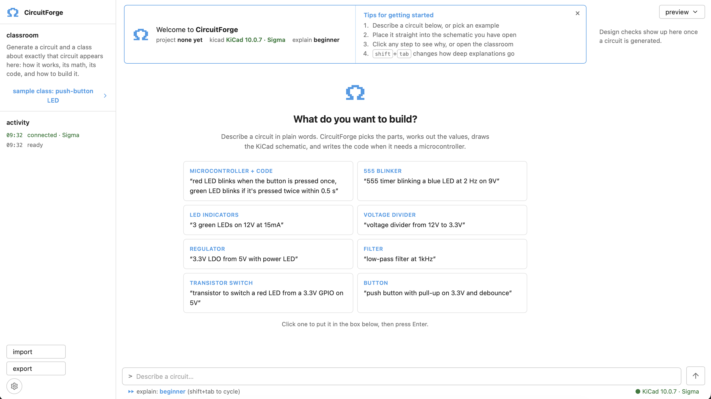

# CircuitForge

A beginner-friendly companion window for KiCad. Describe a circuit in plain English; the engine turns the
words into a fixed list of steps, builds the schematic from circuit rules and math, checks it with KiCad's
own ERC, and explains every decision along the way.

The engine is rule-based (no LLM, no API key needed): your sentence only chooses which knob to turn, and every
value comes from a formula you can read in the lessons. There is an optional model for big Arduino Uno project
descriptions, but it only picks parts and counts, and it's off unless you put a key in `backend/env/gemini.env`.

It builds 9 kinds of circuit: LED, voltage divider, RC filter, 555 blinker, regulator, push button, transistor
switch, Arduino Uno projects (joysticks, buttons, knobs, LEDs, buzzer) and an Arduino Nano with buttons and LEDs,
which also gets C++ firmware.



## Install

In KiCad 10 or newer: **Preferences → Plugins → Enable KiCad API**, then **Tools → Plugin and Content
Manager**, find **CircuitForge** and click **Install**. Open a project's **PCB Editor** (on KiCad 10 plugin
buttons only show up there; KiCad 11 has them in the Schematic Editor too) and click **AI Schematic
Generator**. The CircuitForge window opens next to KiCad; clicking again brings it to the front.

Nothing else to start: the plugin carries the engine and the UI, and the window talks to the engine
directly (no server). Building, developing and publishing: [`kicad-ai-extension/README.md`](kicad-ai-extension/README.md).

## Develop

```bash
cd kicad-ai-extension/backend
python3 -m venv .venv && source .venv/bin/activate
pip install -r requirements.txt
cd ../.. && npm install && npm run build                         # dist/ is not in git; rebuild after you pull
python3 kicad-ai-extension/scripts/package_pcm.py --vendor-dev   # once: pywebview for the plugin
ln -s "$PWD/kicad-ai-extension/plugin" ~/Documents/KiCad/10.0/plugins/ai-schematic-generator
```

Restart KiCad after linking the plugin. No KiCad handy? `python -m app.desktop` in `kicad-ai-extension/backend` opens the
window on its own. For hot reload in a browser, run `uvicorn app.main:app --host 127.0.0.1 --port 8765 --reload` there
and `npm run dev` in the repo root.

Try: *"555 timer blinking a blue LED at 2 Hz on 9V"*, or *"red LED blinks when the button is pressed once, green LED
blinks if it's pressed twice within 0.5 s"* (that one makes a Nano and the code).

| UI | Engine call (bridge name / HTTP endpoint) | What happens |
| --- | --- | --- |
| Prompt box | `generate` / `POST /api/generate` | Rules pick the template; formulas set the values; KiCad's ERC fills in the checks |
| preview | `preview` / `POST /api/desktop/preview` | KiCad draws the exact schematic |
| place in my schematic | `place` / `POST /api/desktop/place` | Copies the circuit so you can paste it into the schematic you have open |
| save / open pcb | `save` / `POST /api/desktop/save` | Saves a **new** project (never overwrites) and opens it |
| export | `export` / `POST /api/desktop/export` | Pictures (SVG, PDF, PNG), the code and the KiCad project in `~/Downloads/CircuitForge` |
| `kicad connected` | `desktop_info` / `GET /api/desktop/info` | Is KiCad installed here, and which project is open? |

In a browser, if the dev service isn't running, the UI says so. The sample class (Classroom card, "sample class") works without it.

**Security.** The KiCad window has no server at all. The development service has no login. It binds to `127.0.0.1`, answers only to `localhost` host names, and lets
only the app window (port 8765) and the dev server (port 5173) call it from a browser (set `ALLOWED_ORIGINS` in
`kicad-ai-extension/backend/.env` to use another port). It writes files and launches KiCad, so don't expose it
on a network.

## Development HTTP API

The KiCad plugin doesn't need it, but the same engine is available over HTTP for development and scripts
(see [`kicad-ai-extension/README.md`](kicad-ai-extension/README.md)):

```bash
cd kicad-ai-extension/backend && source .venv/bin/activate
uvicorn app.main:app --host 127.0.0.1 --port 8765 --reload
```

Health check: curl http://127.0.0.1:8765/api/health


Method	URL	What it does
GET	http://127.0.0.1:8765/api/health	Backend status
POST	http://127.0.0.1:8765/api/generate	Takes {"prompt": "..."} and returns the circuit, the KiCad files, the ERC result, and the code and lesson if there are any
GET	http://127.0.0.1:8765/docs	Interactive API docs
GET	http://127.0.0.1:8765/openapi.json	Machine-readable API spec
POST	http://127.0.0.1:8765/api/generate/save	Same as generate, but also saves it as a new KiCad project and opens it in the Schematic Editor


Request test:

curl -s -X POST http://127.0.0.1:8765/api/generate \
  -H "Content-Type: application/json" \
  -d '{"prompt": "3.3V LDO from 5V with power LED"}' \
  | python3 -c "
import json, sys, pathlib
d = json.load(sys.stdin)
f = d['files']
out = pathlib.Path.home() / 'Documents' / 'KiCad' / 'ai_generated' / f['name']
out.mkdir(parents=True, exist_ok=True)
(out / (f['name'] + '.kicad_sch')).write_text(f['schematic'])
(out / (f['name'] + '.kicad_pro')).write_text(f['project'])
print('Saved to', out)
"

## CircuitForge window

`npm run build` in the repo root builds the UI (from `frontend/`); the plugin package bundles it, and the KiCad toolbar
button opens it as its own app window. Describe a circuit, then place it in your schematic, save it, open the PCB, edit the
C++ (for microcontroller circuits), or export pictures + code.

**Classroom** (top left): a class about the circuit you just generated, built by the backend from that
circuit's own values (`kicad-ai-extension/backend/app/ai/lessons.py`): what it does, each part, its math
(LaTeX + "what if" sliders), the code, how to draw it in KiCad, how it was checked, and quizzes, at three
explanation depths. Each step's "explain" in the transcript opens the matching section.

The class opens on **See it work** (`frontend/components/lab/`), an interactive lab for the exact circuit:

- The real KiCad schematic in 2D (pan, zoom) next to the same circuit built for real in 3D, orbited freely:
  on a solderless breadboard, the way a person would build it (`frontend/lab/breadboard.ts`). Supply and
  ground on the rails, each net on a strip, chips across the centre channel, jumper wires, the battery and an
  Arduino on the desk beside it. X-ray shows the metal strips inside the board, with the current in them.
  The placement is checked: every build connects exactly the pins the schematic does.
- A circuit simulator (`frontend/lab/sim.ts`: nodal analysis, Newton for LEDs/diodes/transistors, time steps
  for capacitors, a behavioural 555, regulators and microcontroller pins) drives everything: electrons (or
  conventional current) move along the actual wires at speeds set by the real current, LEDs glow by their
  current, wires can be coloured by voltage.
- Click anything (a part, one pin, a wire, a junction dot, a label, a power symbol, even the arrows on an
  LED) and it explains itself with live numbers, an analogy, an animated "how it works" cut-away, and controls
  to experiment: hold a button, turn a knob, try another resistor value or LED colour, switch Arduino pins,
  change an input signal.
- **Follow an electron** walks the loop the current actually takes, step by step, with the energy each part
  takes (`frontend/lab/tour.ts`).
- Arduino code really runs (`frontend/lab/arduino.ts`): an interpreter for the C++ Arduino sketches use,
  with AVR-sized integers (an `int` is 16 bits, so the classic overflow bugs happen), millis/delay in
  circuit time, digitalRead/Write, analogRead/Write, tone, shiftOut (a 74HC595 really shifts) and Serial.
  Press the button in the lab and the program decides what the LEDs do.

**Practice** (home screen, or the left panel): build a real circuit from a schematic, or draw the schematic of
a circuit you can turn around in 3D. The checker (`frontend/lab/check.ts`) compares connections, not drawing
style, names mistakes ("D1 is backwards"), and a correct build is switched on in the 3D lab.

**Website only: the Arena** (`frontend/components/arena/`), on when the service runs with `SITE_MODE=web`:

- **Playground:** build anything from the full parts library (with code for an Arduino), run it in the
  2D/3D lab, and get it rated (`frontend/lab/rate.ts`): safety (overcurrent, overheating, shorts, floating
  inputs), efficiency (where every milliwatt goes), cost, better parts and materials, and the code.
- **Speed runs:** timed challenges (`frontend/arena/challenges.ts`) judged by measuring the build in the
  simulator: currents, voltages, blink rates, button behaviour, filter response. Race the clock, par, and
  bots from beginner to legend.
- **Race online:** the same challenges against other people: quick match or a private room with a code.
  The server keeps the clock and a leaderboard (`kicad-ai-extension/backend/app/race.py`).

The KiCad window shows where to find them instead (set `SITE_URL` to link to the website).

The schematic's drawing data (`scene` in `/api/generate`) comes from `backend/app/core/scene.py`, which reads
the generated `.kicad_sch` back and puts a net on every wire, pin, junction and label.
